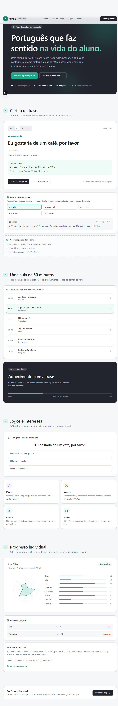

# Classwell (Rampa PLE)

Plataforma de ensino de português para estrangeiros, com trilha por nível (A0, A1, A2...),
rampa de conteúdo, biblioteca, revisão espaçada e acompanhamento individual de alunos.

## Prévia visual

- **GitHub Pages:** <https://originalrj.github.io/Classwell/> — versão estática interativa,
  servida diretamente de [`docs/index.html`](docs/index.html) (não precisa rodar nada).
- **App local:** <http://localhost:3000/prototipo> com o servidor Next rodando (código em
  [`src/app/prototipo/page.tsx`](src/app/prototipo/page.tsx)).

O Pages já está ativado e aponta para `main` / `/docs` (configurado via API em
`POST /repos/{owner}/{repo}/pages`). Cada push no `main` dispara um novo build.

> A versão do Pages é autônoma (HTML/CSS/JS puros) e reproduz as interações da vitrine:
> troca de nível e de frase, dicas por L1, blocos da aula de 50 min, quiz e radar.



A vitrine mostra: cartão de frase PT → EN → "como se fala", dicas por idioma materno,
plano de aula de 50 minutos, mini-jogo, temas de interesse e radar de competências.

## Rodando localmente

Requisitos: **Node 22+** (Node 21 quebra com `ERR_REQUIRE_ESM`) e **JDK 17+** (necessário
apenas para os emuladores Firebase).

```bash
npm install
npm run emulators      # terminal 1
npm run seed:all       # terminal 2 (popular Auth + Firestore)
npm run dev            # terminal 3
```

Abra <http://localhost:3000>. A prévia visual interativa fica em
<http://localhost:3000/prototipo>.

> O `.env.local` de desenvolvimento já vem com `NEXT_PUBLIC_USE_EMULATORS=true`, que conecta
> o app aos emuladores locais (Auth 9099, Firestore 8080, UI 4000). O script `emulators`
> usa `--import/--export-on-exit` em `./emulator-data`, para os dados sobreviverem ao
> reinício. Se preferir começar do zero, use `npm run emulators:clear` e rode `npm run seed:all`.

## Login e cadastro de alunos

O fluxo de professor (`/professor`, `/professor/alunos`, `/professor/alunos/novo`) exige login.

**Conta de demonstração:** `professor@demo.com` / `Demo1234!`

Ela vem com a aluna Ana Silva, avaliação e radar de competências. A biblioteca já é semeada
com **24 aulas** (A1 a C1, ~37 h), publicadas no Firestore.

Para recriar os dados depois de `emulators:clear` (ou se o emulador tiver sido reiniciado
sem persistência):

```bash
npm run seed:all
```

## Estrutura

- `src/app` — rotas da aplicação (rampa, biblioteca, revisão, perfil, área do professor).
- `src/app/prototipo` — vitrine visual interativa do produto planejado.
- `src/components` — interface e componentes de animação.
- `src/lib/domain` — currículo, banco de diagnóstico e regras de nível (dados reais).
- `src/lib/firebase` — inicialização, repositórios e regras de acesso.
- `scripts/seed-a1.ts` … `seed-c1.ts` — as 24 aulas-base em markdown.
- `scripts/seed-biblioteca.ts` — publica as aulas na coleção `contents`.
- `scripts/seed-demo.mjs` — cria professor, aluna e avaliação de demonstração.
- `scripts/verify.ts` — verificação automática da spec (`npm run verify`).
- `SPEC.md` — especificação do produto.

## Verificação

```bash
npm run typecheck
npm run verify
```
